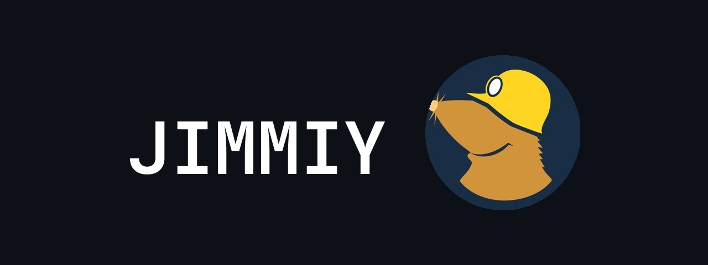

## Hey there! I'm Jimmiy 👋

> **15 y.o. Systems & Low-Latency Developer based in Uzbekistan**  \
> *Passionate about Linux kernel internals, eBPF, network packet inspection, and zero-bloat engineering.*

---

<!-- github-stats:start -->
### GitHub snapshot

| Metric | Count |
| :--- | ---: |
| Public repositories (including forks) | 7 |
| Public non-fork repositories | 4 |
| Stars on public non-fork repositories | 5 |
| Open authored pull requests (across GitHub) | 24 |
| Merged authored pull requests (across GitHub) | 2 |

Updated: 2026-10-13T02:49:20+00:00 (UTC). Source: GitHub REST API.
Repository counts exclude private repositories; fork stars are not counted as original-project stars.
Commit totals, language percentages and developer ranks are intentionally not estimated.
<!-- github-stats:end -->

---

 
  
  
  
  
  
  
  
  
  

 

 
  
  
  
  

 

---

### ⚡ Featured Projects

- 🛡️ **[VORTEX](https://github.com/jimi18102010-commits/vortex)** — Experimental TCP proxy & TLS telemetry *(experimental TCP proxy, TLS telemetry, optional IPv4 XDP blacklist)*
- 👤 **[FaceBlast](https://github.com/jimi18102010-commits/faceblast)** — Ultra-fast, lightweight face detection & recognition *(OpenCV YuNet + SFace ONNX models)*
- 🚀 **[DriveBlast](https://github.com/jimi18102010-commits/Driveblast)** — High-speed Google Drive CLI downloader & document exporter

---

### 🏆 Upstream Open-Source Contributions

- 🌟 **[wkentaro/gdown](https://github.com/wkentaro/gdown)** (5,500+ ⭐) — **Merged** ([PR #532](https://github.com/wkentaro/gdown/pull/532)) • Bare and preview Google Drive file URL support
- ⚡ **[secdev/scapy](https://github.com/secdev/scapy)** (11,500+ ⭐) — **PR Open** ([PR #5214](https://github.com/secdev/scapy/pull/5214)) • Fixed IPv6 Segment Routing Header crash

---

### 🐍 Contribution Activity

  

 

  

### Statistics maintenance

`generate_cards.py` now updates the marked README snapshot and `profile-stats.json`
from GitHub REST API. It no longer creates static SVG counts, language shares or an
unverified developer rank. Existing SVG assets are historical and are not displayed.
The workflow runs daily and can be started manually after this PR is merged.
