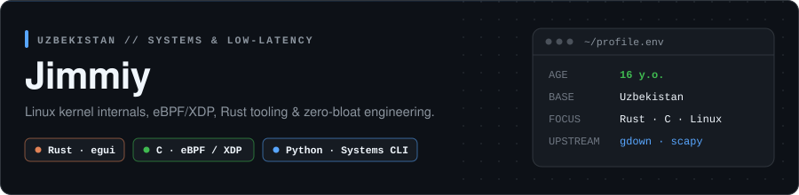
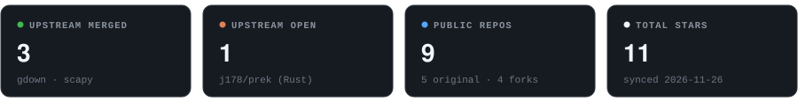

<picture>
  <source media="(prefers-color-scheme: dark)" srcset="assets/hero-dark.svg" />
  <source media="(prefers-color-scheme: light)" srcset="assets/hero-light.svg" />
  
</picture>

  

  

<picture>
  <source media="(prefers-color-scheme: dark)" srcset="assets/stats-dark.svg" />
  <source media="(prefers-color-scheme: light)" srcset="assets/stats-light.svg" />
  
</picture>

---

### Core Stack

  
  
  
  
  
  
  
  
  

---

### Currently Building in Rust

**[PhotoCraft — Social Batch Export](https://github.com/jimi18102010-commits/photocraft)** — A feature fork of the Rust-native PhotoCraft editor adding four social-media presets, crop/fit resizing, PNG/JPEG export, a native `egui` dialog, and a CLI. Originals stay untouched and existing outputs are never overwritten.

*Base editor is upstream work by the ArtCraft team and contributors. This fork contributes the social batch-export feature, engine integration, tests, and docs.*

---

### Featured Projects

| Project | Stack | Focus |
| :--- | :--- | :--- |
| **[PhotoCraft — Jimmiy Edition](https://github.com/jimi18102010-commits/photocraft)** | `Rust · egui · CLI` | Non-destructive social-media batch export (4 presets, crop/fit, no-clobber writes) |
| **[VORTEX](https://github.com/jimi18102010-commits/vortex)** | `C (eBPF/XDP) · Python` | Edge L4/L7 TCP reverse proxy, IPv4 XDP drop filter, JA3/JA4 TLS sniffer & live TUI |
| **[FaceBlast](https://github.com/jimi18102010-commits/faceblast)** | `Python · OpenCV ONNX` | Lightweight face detection & 128-D recognition using YuNet + SFace (no `dlib`/PyTorch) |
| **[DriveBlast](https://github.com/jimi18102010-commits/Driveblast)** | `Python · Rich CLI` | Resumable Google Drive downloader with virus-warning bypass & Docs/Sheets export |

---

### Upstream Open-Source Contributions

| Repository | Status | Contribution |
| :--- | :---: | :--- |
| **[`secdev/scapy`](https://github.com/secdev/scapy)** *(11.5k+ ★)* |  | [PR #5214](https://github.com/secdev/scapy/pull/5214) — Fixed `IndexError` when dissecting IPv6 packets with truncated `nh=43` routing header payloads |
| **[`wkentaro/gdown`](https://github.com/wkentaro/gdown)** *(5.5k+ ★)* |  | [PR #532](https://github.com/wkentaro/gdown/pull/532) — Added bare & `/preview` Google Drive URL resolution with unit tests |
| **[`j178/prek`](https://github.com/j178/prek)** *(Rust)* |  | [PR #2873](https://github.com/j178/prek/pull/2873) — Run `pre-push` hooks against pushed ref contents via temporary detached worktree |

---

### Contribution Activity

  <picture>
    <source media="(prefers-color-scheme: dark)" srcset="https://raw.githubusercontent.com/jimi18102010-commits/jimi18102010-commits/output/github-contribution-grid-snake-dark.svg" />
    <source media="(prefers-color-scheme: light)" srcset="https://raw.githubusercontent.com/jimi18102010-commits/jimi18102010-commits/output/github-contribution-grid-snake.svg" />
    
  </picture>
    
  

